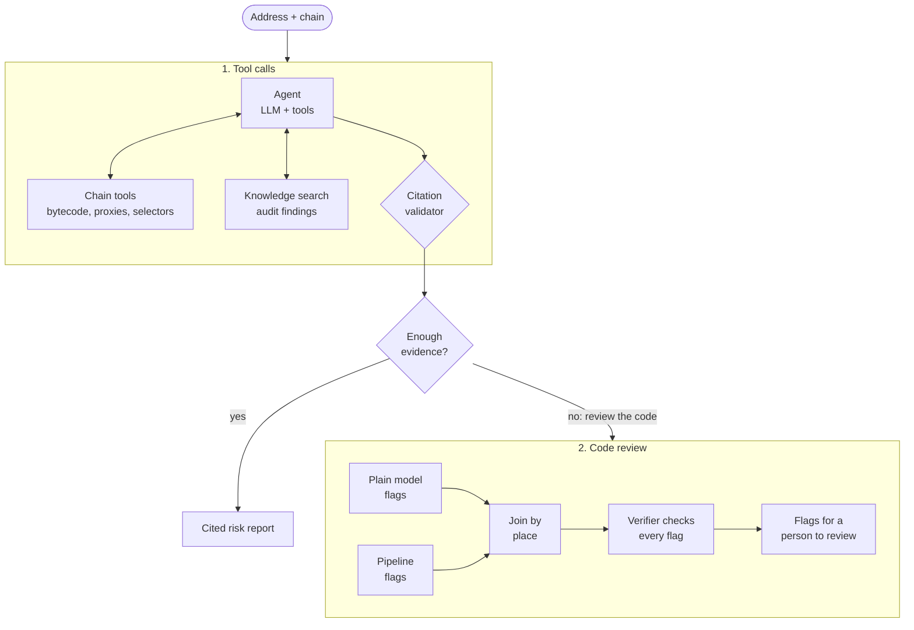

# Smart Contract Analysis Agent

**Ask "is this contract safe to approve?" and get a risk report where every claim cites real evidence, or an honest "insufficient evidence".**
Read-only (no transactions, no keys). Python, 2,400+ offline tests.

## Results

| What I measured | Result | Model |
|---|---|---|
| Finding the right audit knowledge (retrieval, recall@5) | **0.87** on 87 dev questions, **0.97** on 31 held-out | Qwen3-Embedding-8B |
| Claims backed by a real citation | **99.5%** of 1,004 claims in 87 agent runs | DeepSeek Flash |

**What recall@5 means.** The knowledge base holds 54 entries: 35 vulnerability patterns and 19 real
Trail of Bits audit findings. A quiz question describes a situation, such as *"The team can keep
printing more of the coin whenever they like. What is the danger to holders?"*, and I labelled which
entries are the right answer (here, *privileged mint*). The search returns its 5 best matches, and
recall@5 is the share of the right entries that are among those 5. **0.87 means that on average 87%
of the right answers reach the model**, even when the question shares few words with the entry. That
is what lets the agent cite real audit knowledge: it can only cite what the search finds.

**Does re-reading the code find more bugs?** A plain model reads the audited code and flags places
that might be bugs. I added a checklist pipeline (a second set of flags) and a verifier that re-reads
every flag. Scored against the bugs Trail of Bits found in the same code:

| Set | System | Flags | Bugs found | Hit rate |
|---|---|---|---|---|
| Dev (62 bugs) | Plain model | 142 | 13.2 | 8.9% |
| | Plain + pipeline | 196 | 18.2 | 10.0% |
| | Plain + pipeline + verifier | 116 | 16.6 | 14.8% |
| Held-out (51 bugs) | Plain model | 200 | 8.0 | 6.0% |
| | Plain + pipeline | 353 | 9.0 | 4.0% |
| | Plain + pipeline + verifier | 246 | 6.0 | 4.5% |

**Outcome:** the verifier cuts the flags by 30 to 41% against plain + pipeline (196 to 116 on dev,
353 to 246 held-out) but finds fewer bugs too (18.2 to 16.6, 9.0 to 6.0); against the plain model
alone it found more on dev (16.6 vs 13.2) and fewer on held-out (6.0 vs 8.0), so I do not claim it works.

*A flag is a function the system points at. Bugs found counts Trail of Bits findings (Low and
Informational included) that a flag matches; dev is the mean of 5 runs, held-out is 1 run. Hit rate is
the share of flags that match a finding, a lower bound because audits miss bugs. DeepSeek V4.1 Flash
reads, verifies and judges; the judging rubric is still a draft, and the held-out count with Low and
Informational findings was added after the first held-out results, so these numbers are exploratory.*

## How it works



The agent defaults to Claude Sonnet 5.5. Step 2 is built and evaluated but is not yet called by
`python -m agent`; it runs from the eval scripts. All models are reached through OpenRouter.

## Evals

Retrieval and source review each have two sets, so a headline is not measured only on the data it
was tuned on.

* **Dev set:** what I built and tuned against. Exploratory. The verifier's rules and its severity
  cutoff were chosen on dev, so dev numbers flatter it.
* **Held-out set:** set aside before any model ran. The code, the rules and the headline are written
  down first and it is run once. It has since been used three times for source review, so it is no
  longer sealed.

**How they were built**

* **Retrieval quiz:** 125 questions over the 54 knowledge-base entries (paraphrases, raw tool
  signals, code fragments from real audits), drafted by Claude. Each question goes to dev or
  held-out by the hash of its id (30% held out), fixed before any search ran: **87 dev, 38 held-out**
  (31 read so far).
* **Source review:** 12 Trail of Bits audits kept by fixed rules from 69 shortlisted: audited code
  public on GitHub at a commit, a High or Medium finding that names a file, under 200,000 tokens of
  code, and not already in the knowledge base. Whole reports go to one side, in hash order, to the side
  with fewer findings so far: **dev is 5 reports and 29 findings (62 with Low and Informational);
  held-out is 7 reports and 22 findings (51 with them)**.
* **Scoring:** three judge models from three companies vote on whether a flag is the same bug as an
  auditor's finding. A gain counts only if its 95% bootstrap interval excludes zero. Every run is
  logged in [`evals/results.md`](evals/results.md), failures included.

Full tables, intervals and method: [`evals/benchmarks.md`](evals/benchmarks.md).

## Run it

```bash
uv sync && cp .env.example .env     # add your RPC, Etherscan and OpenRouter keys
make test                           # offline tests
python -m agent analyze --contract usdc    # a paid model call, a few cents
```

**Built:** chain tools, reference library, knowledge base, retrieval, agent, evals, source review.
**Not built:** API, web UI, public deployment. [`CLAUDE.md`](CLAUDE.md) is the spec.

MIT licensed ([`LICENSE`](LICENSE)). The audit findings in [`knowledge/findings/`](knowledge/findings)
are adapted from public Trail of Bits reports under CC BY-SA 4.0 ([`NOTICE.md`](knowledge/findings/NOTICE.md)).
