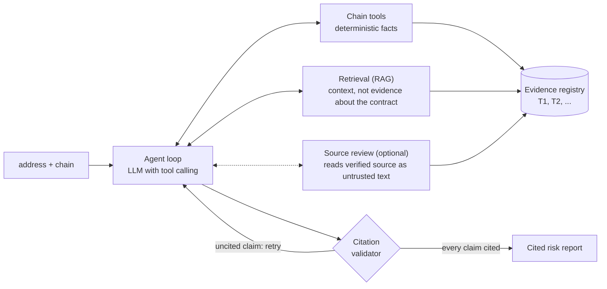

# Smart Contract Analysis Agent

An AI agent that answers one question: **is this smart contract safe to approve?**

You give it a contract address and a chain. It inspects the contract on-chain with read-only
tools, compares it with known contracts, retrieves vulnerability patterns and audit findings, and
returns a risk report in which **every claim cites evidence recorded during that run**. A claim
that cannot point to real evidence is rejected and the model has to try again.

> "Is `0xABC…` on Base safe to approve? It's unverified."
> → fetch the bytecode, resolve any proxy, extract function selectors, match the closest known
> contract, flag the extra and risky functions, retrieve related vulnerability patterns, write a
> cited report, or say `insufficient_evidence` instead of guessing.

Read-only by design: no transactions, no signing, no private keys, no exploit code. Everything the
chain or a retrieved document says is treated as untrusted input.

This repository is also a worked example of the main ideas in AI-agent engineering: tool calling,
RAG, embeddings and vector search, structured output, grounding and citation checks, prompt-injection
defence, evals with a held-out split, LLM-as-judge, and cost control. Each one is mapped to the code
and the decision behind it [below](#the-ai-agent-ideas-and-where-to-find-them).

## How it fits together



**Two systems, one agent.** Deterministic analysis produces *facts* (bytecode, selectors, storage
slots), each cited by chain, address and block. Knowledge retrieval supplies *context*
(vulnerability patterns, audit findings), each cited by document, finding ID and page. Retrieved
text never counts as evidence about the contract being analysed; it only says what the facts might
mean.

| Part | Folder | What it does |
|---|---|---|
| Chain tools | [`chain/`](chain/README.md) | RPC reads: bytecode, proxy resolution (EIP-1967, beacon, EIP-1167), storage, selectors and their names, verified source, deployer, a sandboxed sell rehearsal |
| Reference library | [`references/`](references/README.md) | Known contracts (OpenZeppelin, WETH, a Uniswap V2 pair, popular tokens): match by selector overlap and bytecode, list the extra functions, run risk heuristics |
| Knowledge base | [`knowledge/`](knowledge/README.md) | 35 hand-written vulnerability entries and 19 audit findings parsed from 11 public Trail of Bits reports |
| Retrieval | [`retrieval/`](retrieval/README.md) | Embeddings, in-memory vector search, metadata filters, optional reranker |
| Agent | [`agent/`](agent/README.md) | The tool-calling loop (about 100 lines, no framework), the evidence registry, the report schema, the citation validator |
| Source review | [`review/`](review/) | Reads verified Solidity source with an injection-safe pipeline and returns only closed, checked records |
| Evals | [`evals/`](evals/README.md) | Retrieval quiz, agent run-sets, scorers, a faithfulness judge, the experiment log |

## The AI-agent ideas, and where to find them

| Idea | Where | What was decided, and why |
|---|---|---|
| **Tool calling** | [`agent/tools.py`](agent/tools.py), [`agent/loop.py`](agent/loop.py) | About 15 read-only tools in one registry, each wrapping a tested function. The model asks for tools, the loop runs them and returns the results. Measured on OpenRouter: a model cannot be *forced* to call a tool, so the loop must cope with a plain-text reply. |
| **The agent loop and its limits** | [`agent/loop.py`](agent/loop.py), [`agent/models.toml`](agent/models.toml) | Plain loop, no framework. Caps on model calls (12), tool calls (25), wall clock (420 s), cost ($0.75) and report attempts (3). Near a cap only `submit_report` is offered; at a cap the run ends in `insufficient_evidence` and says which cap. |
| **Structured output** | [`agent/report.py`](agent/report.py) | `{verdict, summary, findings: [{claim, severity, evidence_ids}]}`, validated, never free text. |
| **Grounding and citations** | [`agent/evidence.py`](agent/evidence.py), [`agent/validator.py`](agent/validator.py) | Every tool result and retrieved chunk gets an evidence ID in the run. The validator rejects any claim whose IDs are not from this run, and the model retries. The chain is pinned to one block so all chain evidence is from the same state. |
| **RAG** | [`knowledge/`](knowledge/README.md), [`retrieval/`](retrieval/README.md) | One chunk per taxonomy entry or audit finding (54 chunks, about 14k words), metadata filters (severity, protocol, date, contract kind), results quoted with their IDs and pages. Retrieval gives context; it is never presented as evidence about the contract. |
| **Embeddings** | [`retrieval/embedders.py`](retrieval/embedders.py) | Default Qwen3-Embedding-8B through OpenRouter; a small local model (bge-small) needs no key. Both are scored on the same quiz. |
| **Vector store** | [`retrieval/index.py`](retrieval/index.py) | Vectors held in memory with exact (brute-force) search. At 54 chunks a database index adds setup and no speed. The rule for revisiting it (Postgres plus pgvector, or an approximate index such as HNSW) is: the corpus or the serving load outgrows memory. |
| **Hybrid search and reranking** | [`evals/results.md`](evals/results.md) | BM25 keyword search, hybrid fusion and a cross-encoder reranker were all built and measured. None was shown to beat plain meaning search on the dev questions, so keyword and hybrid were removed. The reranker stays as an option, off by default. Negative results are kept in the log. |
| **Deterministic tools plus an LLM** | [`chain/`](chain/README.md), [`references/`](references/README.md) | Facts come from code that can be unit-tested; the model decides what to look at and writes the judgement. |
| **Prompt-injection defence** | [`agent/untrusted.py`](agent/untrusted.py), [`review/`](review/), [`tests/fixtures/review/hostile/`](tests/fixtures/review) | Names, strings and documents from the chain or the corpus are marked untrusted and kept out of the instructions. The source reviewer strips comments and string literals before a model sees code, fences the code, checks every reply item against the real lines, and a model from another company must agree before anything is rated high. A suite of hostile fixtures (H1 to H22) runs with scripted models. |
| **Evals with a held-out split** | [`evals/`](evals/README.md) | Four layers: retrieval, tool use, detection, answer quality. A dev set for choosing, a held-out set used only at milestones, one experiment log with a row per change. |
| **LLM-as-judge, used carefully** | [`evals/judge/`](evals/judge) | A faithfulness judge with a written rubric, tested on a check set of planted faults. A judge never grades a model from its own company; milestone numbers need two judges from different companies to agree. |
| **Noise and repeatability** | [`evals/results.md`](evals/results.md) | Every contract is run several times and scored three ways (single run, majority, all runs right); intervals resample contracts, not runs. A separate study measures run-to-run noise. |
| **Cost control and caching** | [`evals/spend.py`](evals/spend.py), [`agent/models.toml`](agent/models.toml) | Every paid run prints an estimate first and refuses without an explicit spend cap. Prompt caching (73% of input tokens cached in the dev run); bytecode cached by code hash in Postgres. |
| **Observability** | [`agent/trace.py`](agent/trace.py) | One JSON trace per run: tool calls, tokens, latency, cost. |

## Results

Everything below comes from files in this repository. **All labels were computed by script and
nobody has reviewed them yet**, so the numbers say "agrees with the script and the written rules",
not "is correct". Intervals are 95% bootstrap intervals that resample contracts (or questions), not
runs. The full log is [`evals/results.md`](evals/results.md).

### Retrieval (87 dev questions)

| Variant | recall@5 | Note |
|---|---|---|
| Qwen3-Embedding-8B (default) | 0.87 | MRR 0.88 |
| bge-small (local, no key) | 0.82 | MRR 0.77 |
| bge-small + MiniLM cross-encoder rerank | 0.84 | +0.01 over bge-small, not shown |

On the first 69 dev questions keyword search scored 0.86, meaning search 0.87, hybrid 0.87 and hybrid
plus rerank 0.88; no difference was shown, so the keyword code was removed (it is at commit
`90d2cb1`). The honest reading: at this corpus size the variants are not distinguishable, and the
simplest one stays the default.

### The agent on 29 dev contracts, 3 runs each (87 runs, $0.65, none failed)

DeepSeek V4.1 Flash (the cheap eval tier), no judge. Full record: [`evals/results/2026-10-28-0c888d04-dev-eval-r3.json`](evals/results).

| What | Result |
|---|---|
| Tool-use rules hold (one run / every run) | 0.74 / 0.66 |
| Detection: recall on the 5 flagged contracts | 15 of 15 runs (read it as a count of 5 contracts) |
| Detection: precision of warnings | 0.39 [0.14–0.67] (15 of 38) |
| Citation validity: claims valid / first submit accepted | 0.995 of 1,004 claims / 0.72 |
| Verdict flips between the 3 runs of a contract | 4 of 29 |
| Time and cost per run | median 40 s, p95 86 s; $0.0075 |

**Finding.** The weak number is precision. Seven of 12 labelled-benign obscure tokens were warned on
in every run, because the agent reads a bot blacklist, a tax setter or an owner withdraw in the
code. The labels say "benign by outcome"; the agent says "has risky powers". That is a definitional
conflict between the label and the report, and no label was changed to fit.

### Faithfulness judge on a planted-fault check set

Two judges from different companies caught 37 to 39 of 41 to 44 planted claim faults (0.84 to 0.95)
with at most one false alarm on 46 sound claims; they agreed on the exact label 79% of the time. The
judge is a model's opinion and was not checked against hand labels.

### Source review: a plain model against the pipeline

The same model (Claude Opus 5.5) read 46 dev contracts two ways: plain (raw source, one short neutral
prompt) and through the source-review pipeline (stripped view, 32-entry checklist, span checks).
Planted bugs are new code that no model has seen, each with a fixed "safe twin" and an
identifier-renamed copy as a memorisation control. Method and the exact prompt:
[`evals/source_review/COMPARE.md`](evals/source_review/COMPARE.md); report:
[`evals/source_review/results/`](evals/source_review/results).

| | Plain | Pipeline |
|---|---|---|
| Planted bugs found (12) | 12 | 12 |
| Renamed copies found (12) | 12 | 12 |
| Labelled real incidents found (4, may be memorised) | 1 | 1 |
| Cost for 46 contracts / median per contract | $1.33 / $0.010 | $3.16 / $0.055 |

**What this shows and does not show.** On these items the two are tied, and the planted bugs are too
easy to tell them apart: when 12 of 12 are found by both, the data cannot say one is better (12 of 12
still allows a true rate near 75%). The safe twins exposed a fixture problem: both arms flag the fixed
function in 8 of 12 families, and in some the models are right (one "fix" still lets any caller pick
the slippage bound). Those fixtures need review before any false-alarm rate is quoted. A second
finding: this model on OpenRouter has no endpoint that accepts a JSON-schema response format, so both
arms asked for JSON in the prompt instead.

## Status

Built and tested (about 1,950 tests, no network or model needed): chain tools, reference library,
knowledge base, retrieval, the agent, the evals, and source review. **Not built yet:** the FastAPI
service, the web UI, the tracing dashboard and a public deployment (Component 7). The CI workflow is
parked in [`.github/workflows-disabled/`](.github/workflows-disabled).

## Running it

```bash
uv sync
cp .env.example .env          # RPC URL, Etherscan key, OpenRouter key, optional Postgres
make test                     # ruff + the offline tests
make eval                     # free: retrieval quiz and the scoring of stored traces
python -m agent analyze --contract usdc          # a paid model call, a few cents
python -m evals.source_review compare dry-run    # free: both comparison arms, scripted
```

Paid commands print an estimate and refuse without an explicit spend cap. Secrets live in `.env`
and are never committed. [`CLAUDE.md`](CLAUDE.md) is the spec and the working agreement for the
project.

## Data and attribution

The code is MIT licensed ([`LICENSE`](LICENSE)). The audit findings in [`knowledge/findings/`](knowledge/findings) are adapted from public reports by
Trail of Bits and stay under CC BY-SA 4.0; see [`NOTICE.md`](knowledge/findings/NOTICE.md). Reference
contracts are compiled from OpenZeppelin (MIT) and read from public chains.
