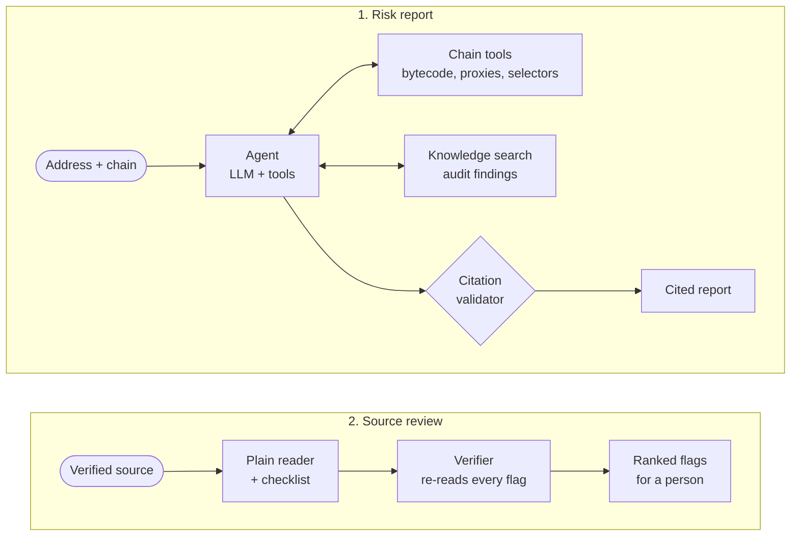

# Smart Contract Analysis Agent

**Ask "is this contract safe to approve?" and get a risk report where every claim cites real evidence, or an honest "insufficient evidence".**
Read-only (no transactions, no keys). Python, 2,400+ offline tests.

## Results

| What I measured | Result | Model |
|---|---|---|
| Finding the right audit finding (retrieval, recall@5) | **0.87** on 87 dev questions, **0.97** on 31 held-out | Qwen3-Embedding-8B |
| Claims backed by a real citation | **99.5%** of 1,004 claims | DeepSeek Flash |
| Cost and speed per analysis | **$0.0075**, median **40 s** | DeepSeek Flash |
| Flagged contracts caught | **15 of 15** runs (but only 39% of its warnings were right) | DeepSeek Flash |
| Source-review verifier, dev set | Flags shown that match a real audit bug: **14.8%** vs **8.9%** for the plain model (+5.9 points, 95% interval +1.5 to +7.3), and 3.4 more of 62 audit findings found | DeepSeek Flash |
| Same verifier, held-out set | **Did not replicate**: 4.5% vs 6.0%. I do not claim it works | DeepSeek Flash |
| Checklist pipeline vs the plain model | **No gain shown**: 12 vs 12 planted bugs; 13 vs 13 (dev) and 12 vs 11 (held-out) real audit issues | Claude Opus 5.5 |

Dev = what I tuned on. Held-out = reports run once, rules fixed beforehand. The judging rubric is
still a draft, so the source-review numbers are exploratory.

## How it works



The agent defaults to Claude Sonnet 5.5; each result above names the model it was measured with
(DeepSeek Flash is DeepSeek V4.1 Flash). All models are reached through OpenRouter.

## How the numbers are kept honest

* Every benchmark has a **dev** group and a **held-out** group, and the headline is committed before any run.
* A gain counts only if its **95% bootstrap interval excludes zero**; otherwise the row says "no improvement shown".
* **Every run is logged**, failures included, in [`evals/results.md`](evals/results.md). Three judge models from three companies vote.

Full tables, intervals and method: [`evals/benchmarks.md`](evals/benchmarks.md).

## Run it

```bash
uv sync && cp .env.example .env     # add your RPC, Etherscan and OpenRouter keys
make test                           # offline tests
python -m agent analyze --contract usdc    # a paid model call, a few cents
```

**Built:** chain tools, reference library, knowledge base, retrieval, agent, evals, source review.
**Not built:** API, web UI, public deployment. [`CLAUDE.md`](CLAUDE.md) is the spec.

MIT licensed ([`LICENSE`](LICENSE)). The audit findings in [`knowledge/findings/`](knowledge/findings)
are adapted from public Trail of Bits reports under CC BY-SA 4.0 ([`NOTICE.md`](knowledge/findings/NOTICE.md)).
