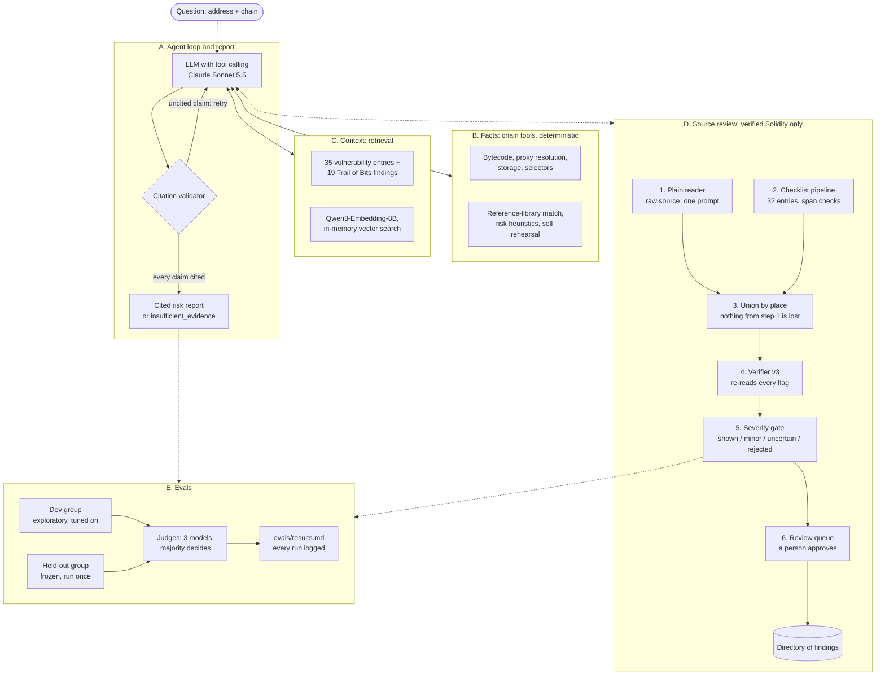

# Smart Contract Analysis Agent

**Is this smart contract safe to approve?** Give the agent an address and a chain and it returns a
risk report in which every claim cites evidence recorded during that run, or says
`insufficient_evidence` instead of guessing. It is read-only: no transactions, no keys, no exploit
code, and everything from the chain or a retrieved document is treated as untrusted input.

The project has two goals, and one rule that covers both:

1. **Facts and context.** Deterministic chain tools produce facts (bytecode, proxy targets, selectors,
   storage). Retrieval over audit findings and a vulnerability taxonomy supplies context. The model
   writes the report; a validator rejects any claim without a real evidence ID.
2. **Read the source like an auditor, and show only what is worth a person's time.** A plain model
   reads verified Solidity and raises flags. Most are false alarms. A checklist pipeline adds flags;
   a verifier re-reads all of them. The goal is more real bugs and fewer false positives than the
   plain model alone, and a human decides what enters the knowledge base.
3. **Measure it, and say so when it does not work.** Every component has a benchmark, a development
   group and a held-out group, and [`evals/results.md`](evals/results.md) logs every run, including
   the ones that failed.

## Which model runs what

| Role | Model | Used for |
|---|---|---|
| Agent (default) | Claude Sonnet 5.5, `anthropic/claude-sonnet-5.5` (cheap tier: Haiku 5.5) | the tool-calling loop and the final report |
| Agent evals, triage, **verifier v3**, source-review dev runs | DeepSeek V4.1 Flash, `deepseek/deepseek-v4.1-flash-1017`, thinking off | every benchmark marked DeepSeek below |
| Source-review head-to-heads | Claude Opus 5.5, `anthropic/claude-opus-5.5` | planted bugs, Sherlock issues, pre-registered Trail of Bits runs |
| Embeddings | Qwen3-Embedding-8B | retrieval |
| Reranker (optional, off by default) | MiniLM cross-encoder, local | retrieval |
| Judges | Z.ai GLM 5.3 Flash, Alibaba Qwen3.7 Flash, DeepSeek V4.1 Flash (dev only, waiver) | 3-judge majority on "is this flag the same bug as the auditors' finding" |

All models are reached through OpenRouter.

## How it works



| Section | What happens | Folder |
|---|---|---|
| A. Agent | Tool loop, evidence registry, structured report, citation validator, caps on calls, time and cost | [`agent/`](agent/README.md) |
| B. Facts | Read-only RPC reads, proxy resolution, selector extraction, bytecode matching, a sandboxed sell rehearsal | [`chain/`](chain/README.md), [`references/`](references/README.md) |
| C. Context | Vulnerability taxonomy and audit findings, searched by meaning; cited by document and finding ID | [`knowledge/`](knowledge/README.md), [`retrieval/`](retrieval/README.md) |
| D. Source review | Plain reader, checklist pipeline, union, verifier, severity gate, review queue | [`review/`](review/), [`verify/`](verify/README.md) |
| E. Evals | Dev and held-out groups, judges, the log | [`evals/`](evals/README.md) |

Steps 1 to 6 of section D are built and tested but run from the eval drivers; `python -m agent` has
only the older single-pipeline `--review` option, and the queue has no command and writes nothing
to the directory yet.

## Benchmarks

### Dev and held-out groups

| Benchmark | Dev group | Held-out group |
|---|---|---|
| Retrieval quiz | 87 questions | 31 original questions (7 newer ones not read) |
| Agent on contracts | 29 contracts, 3 runs each | not run |
| Planted bugs | 46 contracts | not run |
| Sherlock audit issues | 30 issues, 19 files | 26 issues, 21 files |
| Trail of Bits audits | 5 reports, 29 findings (62 with Low and Informational) | 7 reports, 22 findings (51 with Low and Informational) |

### How the numbers are kept fair

* **Dev is for choosing, held-out is for confirming.** Whole reports go to one side (in hash order of
  the report name, to the side with fewer findings so far). Held-out code is frozen and declared
  before the run, and it is run once.
* **The headline and the pass rule are committed before any model runs.** Anything added later is
  labelled post-hoc. A re-run after a fix is labelled "after fix" and the original row stands.
* **"Improvement shown" needs a 95% bootstrap interval that excludes zero**, resampling reports,
  questions or contracts (not runs). Otherwise the row says "no improvement shown".
* **Three judges from three companies, a majority decides.** A judge never grades a model from its
  own company; DeepSeek Flash judging itself on dev is a marked waiver, and those rows say
  "not quotable". The judge rubric is still a draft.
* **The baseline is strong and gets the same files.** Plain = raw source with line numbers, one short
  neutral prompt, a 32,768-token output limit.
* **Run-to-run noise is measured.** Five runs of each arm: one run can mislead (a pipeline run that
  found 10 of 29 findings averaged 5.8 over five).
* **Scored on what is shown, not only on what is found.** The "share of shown places that are right"
  column means a place where a flag was judged the same bug as an auditor's finding. It is a lower
  bound on precision (the auditors' list is incomplete). Writing more flags cannot raise it.
* **Never tuned on held-out.** The verifier was written and tuned on dev. Held-out was used once with Opus
  and again after a reply-reading fix, and a third time to test the verifier; it is no longer sealed.
* **Hard spend caps.** Paid commands refuse to run without an explicit cap.

### At a glance

| Layer | Metric | Dev | Held-out | Model |
|---|---|---|---|---|
| Retrieval | recall@5 | 0.87 | 0.97 | Qwen3-Embedding-8B |
| Retrieval | MRR | 0.88 | 0.96 | Qwen3-Embedding-8B |
| Agent | tool-use rules hold, every run | 0.66 | not run | DeepSeek V4.1 Flash |
| Agent | detection recall, 5 flagged contracts | 15 of 15 runs | not run | DeepSeek V4.1 Flash |
| Agent | detection precision of warnings | 0.39 [0.14–0.67] | not run | DeepSeek V4.1 Flash |
| Agent | claims with a valid citation | 0.995 of 1,004 | not run | DeepSeek V4.1 Flash |
| Source review | planted bugs found (plain / pipeline) | 12 / 12 of 12 | not run | Claude Opus 5.5 |
| Source review | Sherlock issues found (plain / pipeline) | 13 / 13 of 30 | 11 / 12 of 26 | Claude Opus 5.5 |
| Source review | ToB hard findings, pre-registered (plain / pipeline) | 1 / 5 of 21 | 1 / 0 of 20 | Claude Opus 5.5 |
| Source review + verifier v3 | share of shown places that are right, wide key | 14.8% (plain 8.9%) | 4.5% (plain 6.0%) | DeepSeek V4.1 Flash |

### Retrieval (recall@5, 95% bootstrap interval)

| Variant | Dev, 87 questions | MRR | Held-out, 31 questions |
|---|---|---|---|
| Qwen3-Embedding-8B (default) | 0.87 [0.81–0.93] | 0.88 | 0.97 [0.93–1.00] |
| bge-small (local, no key) | 0.82 [0.75–0.89] | 0.77 | not run |
| bge-small + MiniLM rerank | 0.84 [0.77–0.90] | 0.81 | not run |

Keyword and hybrid search were built and measured (0.86 and 0.87 on the first 69 dev questions
against 0.87 for meaning search). None was shown to win, so they were removed.

### Agent on 29 dev contracts, 3 runs each (87 runs, $0.65, none failed)

| What | Result |
|---|---|
| Tool-use rules hold (one run / every run) | 0.74 / 0.66 |
| Detection: recall on the 5 flagged contracts | 15 of 15 runs |
| Detection: precision of warnings | 0.39 [0.14–0.67] (15 of 38) |
| Citation validity: claims valid / first submit accepted | 0.995 of 1,004 claims / 0.72 |
| Verdict flips between the 3 runs of a contract | 4 of 29 |
| Time and cost per run | median 40 s, p95 86 s; $0.0075 |

The weak number is precision: 7 of 12 benign obscure tokens were warned on in every run, because the
agent reads a blacklist, a tax setter or an owner withdraw in the code. The label says "benign by
outcome", the agent says "has risky powers". No label was changed to fit.

### Faithfulness judge (planted faults)

| Judge | Faults caught | False alarms on sound claims |
|---|---|---|
| Alibaba Qwen3.7 Flash | 37 of 44 (0.84) | 0 of 46 |
| Z.ai GLM 5.3 Flash | 39 of 41 (0.95) | 1 of 46 |

The two judges agreed on the exact label 79% of the time. Not checked against hand labels.

### Source review: planted bugs (Claude Opus 5.5)

| | Plain | Pipeline |
|---|---|---|
| Planted bugs found (12) | 12 | 12 |
| Renamed copies found (12) | 12 | 12 |
| Labelled real incidents found (4) | 1 | 1 |
| Cost for 46 contracts | $1.33 | $3.16 |

Tied, and too easy to tell the arms apart.

### Source review: real audit bugs (Claude Opus 5.5)

Sherlock contest issues, judge-validated; each arm reads the affected file alone.

| | Plain | Pipeline |
|---|---|---|
| Dev: found (30 issues) | 13 (0.43) | 13 (0.43) |
| Held-out: found (26 issues) | 11 (0.42 [0.24–0.61]) | 12 (0.46 [0.27–0.67]) |

Held-out: +9%, 95% interval −20% to +57%: **no improvement shown**. The pipeline matches plain at
about 1.4 times the cost.

### Trail of Bits audits: the hardest set

Findings from 12 public Trail of Bits reports, source fetched at the audited commits.
[Rules and every run](evals/datasets/tob_items/README.md).

**Claude Opus 5.5, findings plain missed in screening (pre-registered):**

| | Dev (21 findings) | Held-out (20 findings) |
|---|---|---|
| Plain / pipeline, first run | 1 / 5 (not stable) | 1 / 0 |
| Plain / pipeline, after a reply-reading fix (post-hoc) | 1 / 2 | 1 / 1 |

**DeepSeek V4.1 Flash, all findings, five runs each (dev, post-hoc, not quotable):**

| Arm | Found of 29 (mean, sd) | Found of 62, with Low and Informational |
|---|---|---|
| Plain | 8.6 (1.1) | 13.2 (1.9) |
| Two-pass checklist pipeline | 5.8 (2.4) | 10.2 (3.6) |
| Plain with the checklist added (3 runs) | 5.7 | 8.3 |

Adding the checklist to plain lowered its score, and the checklist pipeline scored below plain too.

### The layered system with verifier v3

Plain, then the pipeline, joined by place, then verifier v3 re-reads every flag (1,232 flags on dev,
436 on held-out) and a place is shown if a flag in it is valid at severity low or up.
DeepSeek V4.1 Flash throughout. One plain run and one pipeline run per pair; five pairs on dev, one
on held-out. Not quotable (draft rubric, DeepSeek also judges).

**Dev group (5 reports)**

| System | Places shown | Found of 62 | Right | Found of 29 | Right |
|---|---|---|---|---|---|
| Plain alone | 142 | 13.2 | 8.9% | 8.6 | 5.9% |
| Plain + pipeline, every flag shown | 196 | 18.2 | 10.0% | 10.4 | 6.1% |
| + verifier v3, severity low or up | 116 | 16.6 | 14.8% | 9.0 | 8.2% |
| + verifier v3, severity medium or up | 65 | 11.2 | 17.4% | 6.2 | 9.2% |

**Held-out group (7 reports)**

| System | Places shown | Found of 51 | Right | Found of 22 | Right |
|---|---|---|---|---|---|
| Plain alone | 200 | 8.0 | 6.0% | 4 | 2.0% |
| Plain + pipeline, every flag shown | 353 | 9.0 | 4.0% | 5 | 1.4% |
| + verifier v3, severity low or up | 246 | 6.0 | 4.5% | 3 | 1.2% |
| + verifier v3, severity medium or up | 119 | 4.0 | 7.6% | 3 | 2.5% |

* **On dev** the verifier shortens the list by 41% against plain + pipeline for 9% fewer findings
  and lifts the right-share from 10.0% to 14.8%; the gain over plain alone is +3.4 findings
  [+0.6, +7.2] and +5.9 points of right-share [+1.5, +7.3] (wide key).
* **On held-out it did not replicate.** The list is 30% shorter than plain + pipeline, but it finds
  fewer than plain (6.0 against 8.0 of 51) and its right-share is lower than plain's (4.5% against
  6.0%). Findings were found in only 4 of the 7 reports, so the test is weak; it gives the dev result
  no support.
* **Why dev flatters it.** The severity cutoff was picked from seven candidates on dev, and the
  verifier's rules were written after reading its dev rejections. The pre-registered rule is
  "no improvement shown" on held-out, on both keys.

## Status

About 2,500 tests, none needing a network or a model. Built: chain tools, reference library,
knowledge base, retrieval, the agent, the evals, source review, the layered run, the verifier and the
review queue. Not built: the FastAPI service, web UI, tracing dashboard and a public deployment; the
layered run and the queue are not reachable from `python -m agent`; nothing writes approved findings
into the directory. The scripts that produced the layered-system and verifier tables are not in the repo yet (the settings and commits are in the log). A fair test of the verifier needs reports nobody has read. CI is parked in
[`.github/workflows-disabled/`](.github/workflows-disabled).

## Running it

```bash
uv sync
cp .env.example .env          # RPC URL, Etherscan key, OpenRouter key, optional Postgres
make test                     # ruff + the offline tests
make eval                     # free: retrieval quiz and the scoring of stored traces
python -m agent analyze --contract usdc          # a paid model call, a few cents
```

Paid commands print an estimate and refuse without an explicit spend cap. Secrets live in `.env`
and are never committed. [`CLAUDE.md`](CLAUDE.md) is the spec and working agreement.

MIT licensed ([`LICENSE`](LICENSE)). The audit findings in [`knowledge/findings/`](knowledge/findings)
are adapted from public Trail of Bits reports and stay under CC BY-SA 4.0
([`NOTICE.md`](knowledge/findings/NOTICE.md)).
