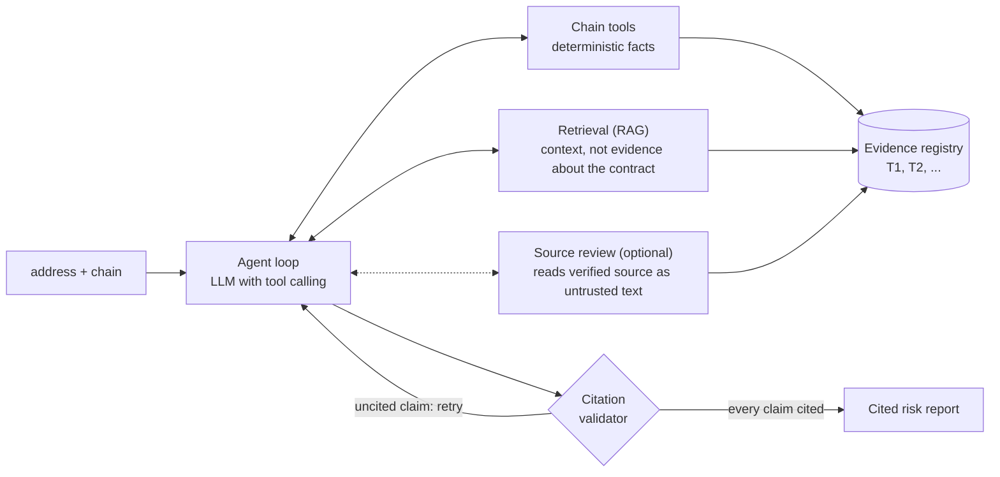

# Smart Contract Analysis Agent

An AI agent that answers one question: **is this smart contract safe to approve?** Give it an
address and a chain ("Is `0xABC…` on Base safe to approve? It's unverified.") and it returns a risk
report in which every claim cites evidence recorded during that run, or says `insufficient_evidence`
instead of guessing.

It is built from scratch in Python 3.12 with no agent framework: a **tool-calling loop** over Claude
(through OpenRouter) and about 15 read-only tools (RPC reads, EIP-1967 and EIP-1167 proxy resolution,
function-selector extraction, bytecode matching against a reference library, a sandboxed Foundry
fork that rehearses a token sell), plus a **RAG** layer: 35 hand-written vulnerability entries and
findings from 11 public Trail of Bits audits, embedded with Qwen3-Embedding-8B, searched in memory
(exact vector search) with metadata filters and an optional cross-encoder reranker. A tree-sitter
based reviewer can also read verified Solidity as untrusted text. The model must answer in a
**structured JSON report**, and a **citation validator** rejects any claim that does not point at a
real evidence ID from the run, so the model has to retry. The whole thing is measured by a
four-layer **eval harness**: a held-out split, bootstrap intervals, LLM-as-judge from different
companies, run-to-run noise studies and hard spend caps. It is read-only: no transactions, no keys,
no exploit code, and everything from the chain or a retrieved document is treated as untrusted input.

## How it fits together



**Two systems, one agent.** Deterministic analysis produces *facts* (bytecode, selectors, storage
slots), each cited by chain, address and block. Knowledge retrieval supplies *context*
(vulnerability patterns, audit findings), each cited by document, finding ID and page. Retrieved
text never counts as evidence about the contract being analysed; it only says what the facts might
mean.

| Part | Folder | What it does |
|---|---|---|
| Chain tools | [`chain/`](chain/README.md) | RPC reads: bytecode, proxy resolution, storage, selectors and their names, verified source, deployer, a sandboxed sell rehearsal |
| Reference library | [`references/`](references/README.md) | Known contracts (OpenZeppelin, WETH, a Uniswap V2 pair, popular tokens): match by selector overlap and bytecode, list the extra functions, run risk heuristics |
| Knowledge base | [`knowledge/`](knowledge/README.md) | 35 hand-written vulnerability entries and 19 audit findings parsed from 11 public Trail of Bits reports |
| Retrieval | [`retrieval/`](retrieval/README.md) | Embeddings, in-memory vector search, metadata filters, optional reranker |
| Agent | [`agent/`](agent/README.md) | The loop (about 100 lines), the evidence registry, the report schema, the citation validator, caps on calls, time and cost |
| Source review | [`review/`](review/) | Reads verified Solidity with an injection-safe pipeline and returns only closed, checked records |
| Evals | [`evals/`](evals/README.md) | Retrieval quiz, agent run-sets, scorers, a faithfulness judge, the experiment log |

## Results

Everything below comes from files in this repository. **All labels were computed by script and
nobody has reviewed them yet**, so the numbers say "agrees with the script and the written rules",
not "is correct". Intervals are 95% bootstrap intervals that resample contracts (or questions), not
runs. The full log is [`evals/results.md`](evals/results.md).

### Retrieval (87 dev questions)

| Variant | recall@5 | Note |
|---|---|---|
| Qwen3-Embedding-8B (default) | 0.87 | MRR 0.88 |
| bge-small (local, no key) | 0.82 | MRR 0.77 |
| bge-small + MiniLM cross-encoder rerank | 0.84 | +0.01 over bge-small, not shown |

Keyword search and hybrid fusion were built and measured too (0.86 and 0.87 on the first 69 dev
questions, against 0.87 for meaning search). None was shown to beat meaning search, so they were
removed; the simplest variant stays the default.

### The agent on 29 dev contracts, 3 runs each (87 runs, $0.65, none failed)

DeepSeek V4.1 Flash (the cheap eval tier), no judge. Full record:
[`evals/results/2026-10-28-0c888d04-dev-eval-r3.json`](evals/results).

| What | Result |
|---|---|
| Tool-use rules hold (one run / every run) | 0.74 / 0.66 |
| Detection: recall on the 5 flagged contracts | 15 of 15 runs (read it as a count of 5 contracts) |
| Detection: precision of warnings | 0.39 [0.14–0.67] (15 of 38) |
| Citation validity: claims valid / first submit accepted | 0.995 of 1,004 claims / 0.72 |
| Verdict flips between the 3 runs of a contract | 4 of 29 |
| Time and cost per run | median 40 s, p95 86 s; $0.0075 |

**Finding.** The weak number is precision. Seven of 12 labelled-benign obscure tokens were warned on
in every run, because the agent reads a bot blacklist, a tax setter or an owner withdraw in the
code. The labels say "benign by outcome"; the agent says "has risky powers". That is a definitional
conflict between the label and the report, and no label was changed to fit.

### Faithfulness judge on a planted-fault check set

Two judges from different companies caught 37 to 39 of 41 to 44 planted claim faults (0.84 to 0.95)
with at most one false alarm on 46 sound claims, and agreed on the exact label 79% of the time. The
judge is a model's opinion and was not checked against hand labels.

### Source review: a plain model against the pipeline

The same model (Claude Opus 5.5) read 46 dev contracts two ways: plain (raw source, one short neutral
prompt) and through the source-review pipeline (stripped view, 32-entry checklist, span checks).
Planted bugs are new code that no model has seen, each with a fixed "safe twin" and an
identifier-renamed copy as a memorisation control. Method and the exact prompt:
[`evals/source_review/COMPARE.md`](evals/source_review/COMPARE.md).

| | Plain | Pipeline |
|---|---|---|
| Planted bugs found (12) | 12 | 12 |
| Renamed copies found (12) | 12 | 12 |
| Labelled real incidents found (4, may be memorised) | 1 | 1 |
| Cost for 46 contracts / median per contract | $1.33 / $0.010 | $3.16 / $0.055 |

**What this shows and does not show.** The two are tied, and the planted bugs are too easy to tell
them apart: 12 of 12 for both still allows a true rate near 75%. The safe twins exposed a fixture
problem: both arms flag the fixed function in 8 of 12 families, and in some the models are right
(one "fix" still lets any caller pick the slippage bound), so no false-alarm rate is quoted. This
model on OpenRouter also has no endpoint that accepts a JSON-schema response format, so both arms
asked for JSON in the prompt instead.

### Real, judged bugs: plain model against the pipeline

Rules and headline were committed before any run ([`evals/datasets/audit_items/`](evals/datasets/audit_items)).
Issues come from public, judge-validated Sherlock contest reports (2025); each arm reads the affected
file alone. Dev was exploratory; held-out was run once with the code frozen.

| | Plain | Pipeline |
|---|---|---|
| Dev: judged issues found (30, 19 files) | 13 (0.43) | 13 (0.43) |
| Held-out: judged issues found (26, 21 files) | 11 (0.42 [0.24–0.61]) | 12 (0.46 [0.27–0.67]) |
| Held-out cost | $1.56 | $2.14 |

**Result: no improvement shown.** Held-out relative improvement is +9% with a 95% interval of −20% to
+57%, and both arms miss more than half of the judged bugs, mostly business-logic and accounting
errors that need more than one file of context. On recall the pipeline matches the plain model at
about 1.4 times the cost; what it adds is checked, span-verified output and injection hardening,
which this test does not measure. The pre-registered rule only allows an "x% better" claim when that
interval excludes zero.

## Status

Built and tested (about 2,000 tests, no network or model needed): chain tools, reference library,
knowledge base, retrieval, the agent, the evals and source review. **Not built yet:** the FastAPI
service, web UI, tracing dashboard and a public deployment. CI is parked in
[`.github/workflows-disabled/`](.github/workflows-disabled).

## Running it

```bash
uv sync
cp .env.example .env          # RPC URL, Etherscan key, OpenRouter key, optional Postgres
make test                     # ruff + the offline tests
make eval                     # free: retrieval quiz and the scoring of stored traces
python -m agent analyze --contract usdc          # a paid model call, a few cents
```

Paid commands print an estimate and refuse without an explicit spend cap. Secrets live in `.env`
and are never committed. [`CLAUDE.md`](CLAUDE.md) is the spec and working agreement.

MIT licensed ([`LICENSE`](LICENSE)). The audit findings in [`knowledge/findings/`](knowledge/findings)
are adapted from public Trail of Bits reports and stay under CC BY-SA 4.0
([`NOTICE.md`](knowledge/findings/NOTICE.md)).
